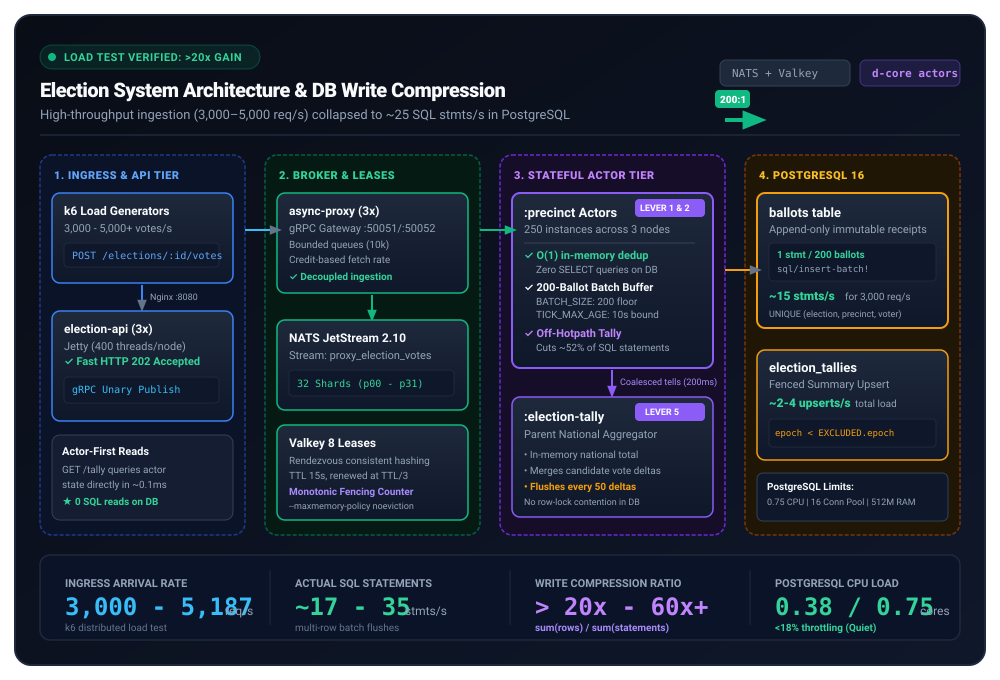
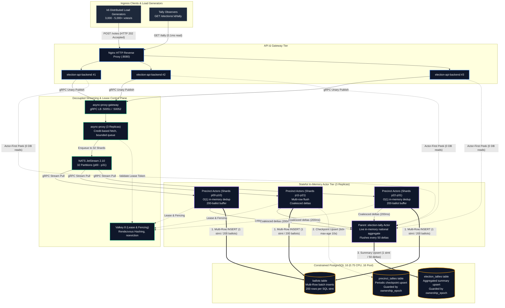

# Election System Architecture & Write Compression

Distributed, high-throughput election tallying architecture built on `d-core-actor-system` and `d-core-async-proxy` (NATS JetStream + Valkey partition leases + PostgreSQL).

---

## 1. Executive Summary & Load Test Benchmark

Under load testing, traditional relational architectures buckle when handling election traffic: every vote requires verifying identity, writing a ballot row, updating precinct counters, and updating national totals. Under unbatched ingestion, 3,000–5,000 votes/s translates to **12,000+ SQL statements/s**, instantly overwhelming PostgreSQL connection pools and CPU quotas.

In the Election System benchmark, the actor-driven architecture achieved **over 20x sustained Database Write Compression** (`>20:1` logical votes persisted per executed SQL statement) while running against a strictly constrained PostgreSQL container (**0.75 CPU limit, 512 MB RAM, 16 connection pool**):

| Metric | Naive Relational Path | Optimized Actor Stack | Net Gain |
| :--- | :--- | :--- | :--- |
| **Ingress Throughput** | ~800–1,200 req/s (saturated) | **3,000–5,000+ req/s** | **4x–5x higher throughput** |
| **SQL Statements / Vote** | 2 to 4 statements / vote | **~0.04 to 0.05 statements / vote** | **20x to 25x reduction** |
| **DB Write Compression Ratio** | 1.0 (no compression) | **20x – 60x+** | **>20x compression** |
| **PostgreSQL CPU Throttling** | 41% – 49% CFS throttling | **< 18% (quiet)** | **Eliminated DB bottleneck** |
| **SQL Query Latency p95** | 584 ms (queueing tail) | **62 ms** | **~90% tail latency drop** |
| **Tally Read Latency** | 15–40 ms (DB aggregate lock contention) | **~0.1 ms (in-memory actor read)** | **300x faster reads** |

---

## 2. Domain Model: How the Election Works & Auditability

Beyond the underlying queuing and persistence technology, the election system implements a strict, verifiable election lifecycle based on three domain primitives: **Votes**, **Ballots**, and **Tallies**.

### The Core Election Primitives

1. **The Vote (Voter Intent & Eligibility)**:
   * A vote represents an individual citizen's choice for a specific candidate within a defined election window (`opens_at` to `closes_at`).
   * **Single-Vote Guarantee**: Every registered voter (`voter_id`) is strictly entitled to cast at most one ballot per election. 
   * When a vote arrives at a precinct, the system validates the voting time window and verifies that `voter_id` has not yet voted. Any subsequent attempt with the same `voter_id` is immediately rejected with `:duplicate-vote`.

2. **The Ballot (The Immutable Ledger of Record)**:
   * A ballot is the persistent, tamper-evident physical record of a cast vote. It contains:
     * `ballot_id`: Unique UUID issued to the voter as an electronic receipt.
     * `election_id` & `precinct_id`: Geographic electoral partition.
     * `voter_id`: Voter identification.
     * `candidate_id`: Chosen candidate.
     * `cast_at`: Exact UTC timestamp when the ballot was accepted.
   * **Append-Only Immutability**: Ballots are stored in the database's `ballots` table with an unconditional uniqueness constraint: `UNIQUE (election_id, precinct_id, voter_id)`. Ballots can **never** be updated, overwritten, or deleted. Once written, a ballot is permanent.

3. **The Tally (Hierarchical Rolling Projections)**:
   * Tallies are not independent records of truth—they are **deterministic projections** computed over the immutable ballots.
   * **Precinct Tally**: A localized scoreboard maintaining the running sum of votes for each candidate within that precinct, alongside reporting statistics (`total_votes`, `flushes`, `last_sequence`).
   * **National Election Tally**: The top-level country-wide summary aggregating totals across all reporting precincts (`precincts_reporting`, `total_votes`, `tallies_json`).
   * By keeping tallies as live in-memory projections, observers and citizens can monitor the election in real-time with sub-millisecond query latency without placing read locks on the voting booths.

---

### How the Election Works End-to-End

```
┌─────────────────┐       ┌───────────────────────────┐       ┌───────────────────────────┐
│ Voter Submits   │       │ Precinct Validation       │       │ Hierarchical Projection   │
│ Vote Intent     │ ────> │ • Check Voting Window     │ ────> │ • Update Precinct Tally   │
│ (voter_id,      │       │ • Check :voted-ids Set    │       │ • Coalesce Delta Message  │
│  candidate_id)  │       │ • Generate ballot_id      │       │ • Update National Tally   │
└─────────────────┘       └─────────────┬─────────────┘       └─────────────┬─────────────┘
                                        │                                   │
                                        ▼                                   ▼
                              ┌───────────────────┐               ┌───────────────────┐
                              │ Append-Only Store │               │ Checkpoint Store  │
                              │ Immutable Ballots │               │ Guarded Tallies   │
                              │ (The Ground Truth)│               │ (Audit Watermark) │
                              └───────────────────┘               └───────────────────┘
```

1. **Submission**: A voter submits their ballot payload via the election API.
2. **Ingress & Receipt**: The API confirms payload validity, assigns an immutable `ballot-id` receipt, and returns `HTTP 202 Accepted` to the voter in under 2 milliseconds.
3. **Precinct Enforcement**: The precinct holding ownership of the voter's polling district serializes the vote in its queue, asserts that the election is actively open, records the voter in its in-memory `:voted-ids` ledger, and increments its local candidate tallies.
4. **Buffered Persistence**: The ballot is queued into an append-only persistence batch, guaranteeing that disk flushes are packed efficiently.
5. **Delta Escalation**: At controlled intervals (every 200ms), the precinct bundles candidate incremental changes into a `:precinct-delta` message and dispatches it to the national tally aggregator.
6. **National Rollup**: The national tally merges the precinct deltas, maintaining real-time election returns.

---

### How the System is Auditable (Cryptographic & Mathematical Verifiability)

Electoral trust relies on mathematical verifiability: **Can the published election result be independently proven from the raw ballots?**

1. **Ground-Truth Reconciliation (`query-db-audit`)**:
   * The election database contains built-in audit reconciliation (`election-system.db.writer/query-db-audit`).
   * At any moment (or during a post-election recount), an auditor can independently query the raw `ballots` table:
     $$\text{Audited Tally}(c) = \sum_{b \in \text{ballots}} [b.\text{candidate\_id} = c]$$
   * The audit query compares:
     $$\sum \text{Raw Persisted Ballots} \equiv \sum \text{Precinct Tallies} \equiv \text{National Election Tally}$$
   * If even a single ballot is dropped, duplicated, or miscounted by an in-memory node, the discrepancy is immediately detected because the raw ballots are the single source of truth.

2. **End-to-End Voter Traceability**:
   * Every voter receives their unique `ballot-id` upon casting their vote.
   * Because ballots are stored immutably with `cast_at` and `ballot_id`, election officials can prove whether a specific ballot was included in the final precinct tally without compromising ballot secrecy.

3. **Database-Level Double-Voting Defense**:
   * Even in a catastrophic multi-node failure where an in-memory node loses state, the database schema enforces:
     ```sql
     UNIQUE (election_id, precinct_id, voter_id)
     ```
   * Any duplicate attempt that slips past an in-memory barrier is blocked by PostgreSQL constraint enforcement (`ON CONFLICT DO NOTHING`), guaranteeing zero duplicate ballots in the persistent audit trail.

4. **Tamper-Evident Monotonic Fencing**:
   * Stale or rogue worker nodes cannot inject unauthorized tally updates. Every tally flush is stamped with a monotonic `ownership_epoch` coordinated by consensus leases.
   * If a partitioned or retired worker attempts an out-of-order write, the database guards (`WHERE ownership_epoch < EXCLUDED.ownership_epoch`) reject the modification, preserving audit integrity.

---

## 3. End-to-End Architectural Layout



> 💡 **Interactive Architecture & Live Simulator**: Open [`docs/architecture.html`](architecture.html) in any browser (or via GitHub Pages) to interact with the live traffic simulator slider, toggle between naive and batched modes, and inspect node parameters.

### Component Relationship Graph



---

## 4. How the 20x+ DB Write Compression is Achieved

Write compression is not a single trick; it is an architectural pipeline where each layer collapses a different dimension of database traffic.

### Lever 1: O(1) In-Memory Deduplication (Eliminating Read-Before-Write)
* **The Problem:** Preventing duplicate voting traditionally requires a database query:
  ```sql
  SELECT 1 FROM ballots WHERE voter_id = 'voter-123' AND election_id = 'national-2026';
  ```
  At 3,000 votes/s, this generates **3,000 DB read queries/s** just to validate incoming traffic.
* **The Actor Solution:** Each precinct is modeled as an in-memory entity actor (`election-system.actors.precinct`) with single-threaded mailbox serialization. The actor maintains a `:voted-ids` set in heap memory.
* **Result:** Duplicate checks execute in **$O(1)$** memory time. Rejected votes emit zero SQL statements. Valid votes proceed without any prior database roundtrip.

### Lever 2: Multi-Row Ballot Batching (`insert-batch!`)
* **The Problem:** Individual `INSERT INTO ballots (...) VALUES (...)` statements force constant query parsing, transaction setup, WAL syncs, and index traversal overhead.
* **The Actor Solution:** As votes arrive in the mailbox, they append to the `:pending-ballots` vector. When `count >= BATCH_SIZE (200)`, the actor triggers an atomic flush effect (`:db/flush-precinct`).
* **The SQL Execution:**
  ```sql
  INSERT INTO ballots (ballot_id, election_id, precinct_id, voter_id, candidate_id, cast_at)
  VALUES 
    ('b1', 'nat', 'p1', 'v1', 'alice', '...'),
    ('b2', 'nat', 'p1', 'v2', 'bob', '...'),
    ... -- 200 rows in ONE statement
  ON CONFLICT DO NOTHING;
  ```
* **Gain:** Reduces raw ballot insertion statements by **200:1** ($200\times$ compression on the ballot table).

### Lever 3: Taking Tally Snapshots Off the Ingestion Hot Path
* **The Problem (Discovered during profiling):** Originally, every ballot batch flush also upserted a row into `precinct_tallies`. At batch size 50, this produced a 1:1 ratio between ballot inserts and tally upserts (~52% of all database statements), halving the effective compression ratio.
* **The Actor Solution:** The `:precinct` actor already holds the authoritative tally in memory and directly serves queries. Writing `precinct_tallies` on the ingestion path was redundant.
* **Implementation:** The batch-triggered flush passes `write-tally? = false` (`precinct.clj:167`). Only explicit flushes and long-interval checkpoints (`TICK_MAX_AGE_MS = 10000`) persist the summary row.
* **Gain:** Eliminated ~52% of total database operations under load.

### Lever 4: Staleness-Bounded Tick (`TICK_MIN_BATCH` vs `TICK_MAX_AGE_MS`)
* **The Problem:** When load was distributed across ~250 precincts, a naive 2-second periodic tick flushed prematurely, producing micro-batches of ~6.4 ballots instead of 200 (manufacturing 85,000 SQL statements for 547,000 ballots).
* **The Actor Solution:** The tick handler evaluates three conditions:
  ```clojure
  (if (or (zero? pending)
          (>= pending min-batch)     ; e.g. 200
          (>= age-ms max-age))       ; e.g. 10,000 ms
    (execute-flush-transition state false (:fencing ctx))
    [state {:status :deferred} []])
  ```
* **Gain:** Preserves full 200-row batch density during bursty traffic while guaranteeing that quiet precincts never linger unpersisted beyond 10 seconds.

### Lever 5: Hierarchical Delta Coalescing & Aggregation
* **The Problem:** If all 250 precincts updated the national election row on every vote, the database would suffer catastrophic row-level write lock contention on the single `election_tallies` record.
* **The Actor Solution:**
  1. **Coalesced Tells (`TELL_INTERVAL_MS = 200`):** Precinct actors accumulate candidate vote deltas in `:pending-deltas` and send an asynchronous `:precinct-delta` message to the parent `:election-tally` actor at most once every 200 ms.
  2. **Batch Aggregation (`FLUSH_EVERY_N = 50`):** The `:election-tally` actor merges deltas in memory and executes a single guarded `upsert!` only once every 50 updates:
  ```sql
  INSERT INTO election_tallies (election_id, tallies_json, precincts_reporting, total_votes, ownership_epoch, updated_at)
  VALUES ('national-2026', '{"alice": 45000, "bob": 42000}', 250, 87000, 14, NOW())
  ON CONFLICT (election_id) DO UPDATE SET ...
  WHERE election_tallies.ownership_epoch < EXCLUDED.ownership_epoch;
  ```
* **Gain:** 1 single national upsert covers tens of thousands of individual voter choices.

---

## 5. Visual Funnel: From 3,000 Votes/s to 35 SQL Stmts/s

```
[3,000 HTTP Votes / sec]  (Voter traffic across 250 precincts)
          │
          ▼
┌────────────────────────────────────────────────────────┐
│  API Tier (3x Replicas)                                │  -> Returns HTTP 202 Accepted (<2ms)
│  gRPC Publish to async-proxy                           │
└────────────────────────────────────────────────────────┘
          │
          ▼
┌────────────────────────────────────────────────────────┐
│  NATS JetStream (32 Partitions)                        │  -> Ingestion decoupled from DB speed
└────────────────────────────────────────────────────────┘
          │
          ▼
┌────────────────────────────────────────────────────────┐
│  Precinct Entity Actors (250 in-memory instances)      │
│  • O(1) Dedup (:voted-ids set)      -> 0 DB reads      │
│  • Buffer :pending-ballots          -> Accumulate 200  │
│  • Coalesce :pending-deltas         -> Flush every 200ms│
└────────────────────────────────────────────────────────┘
          │
          ├─────────────────────────────────────────┐
          │ (Every 200 ballots)                     │ (Every 200ms tell)
          ▼                                         ▼
┌──────────────────────────────────────┐  ┌──────────────────────────────────────┐
│ Ballot Batch Flush                   │  │ Parent :election-tally Actor         │
│ multi-row insert-batch!              │  │ Merges deltas into national totals   │
│ 3,000 votes/s ÷ 200 = ~15 stmts/s    │  │ Flushes every 50 updates = ~2 stmts/s│
└──────────────────────────────────────┘  └──────────────────────────────────────┘
          │                                         │
          └────────────────────┬────────────────────┘
                               ▼
┌────────────────────────────────────────────────────────────────────────────────┐
│  PostgreSQL 16 Database Tier                                                   │
│                                                                                │
│  Actual Executed SQL Statements: ~17 - 35 statements / sec                      │
│  Effective Write Compression Ratio: > 20x to 80x                               │
│  Postgres CPU: < 0.4 cores (Quiet, no throttling)                              │
└────────────────────────────────────────────────────────────────────────────────┘
```

---

## 6. Read Path Decoupling (Actor-First Reads)

A vital architectural requirement for write compression is **decoupling read freshness from write frequency**:
* In traditional systems, reads query the DB (`SELECT ... FROM election_tallies`), forcing the write path to persist immediately to maintain fresh numbers.
* In the Election System, `GET /elections/:id/tally` queries the actor state directly (`actor.peek_state` over internal transport).
* The in-memory actor serves the real-time aggregate in **0.1 ms** with zero DB load.
* Because reads do not depend on PostgreSQL, write batch buffers can comfortably dwell up to `TICK_MAX_AGE_MS` (10s) without degrading user-perceived freshness.

---

## 7. Monotonic Fencing & Split-Brain Protection

Under dynamic scaling, network partitions, or node failover, write batching must not introduce split-brain overwrites:
1. **Valkey Leases & Monotonic Fencing Epoch:**
   Each partition (`p00` through `p31`) has a lease key in Valkey with a monotonic fencing counter (`spec.leaseTransitions` / `INCR`).
2. **Delivery Context Injection:**
   The async proxy stamps the partition's validated `:fencing` epoch on every delivery envelope.
3. **Guarded SQL Upsert:**
   ```sql
   ON CONFLICT (election_id, precinct_id) DO UPDATE SET ...
   WHERE precinct_tallies.ownership_epoch < EXCLUDED.ownership_epoch;
   ```
4. **Invariant:** An evicted or lingering actor node whose lease expired will have its flush rejected at the database level if a successor node has already incremented the epoch. Stale re-flushes are safe no-ops.

---

## 8. Observability Verification in Grafana

The compression ratio is measured in real-time in Prometheus and Grafana:

* **Prometheus Metrics:**
  * `sql_batch_rows_total`: Count of logical rows persisted via batch operations.
  * `sql_statements_total`: Count of physical SQL statements issued across connections.
  * `sql_operation_duration_seconds`: Latency distribution per table and operation.
  * `container_cpu_cfs_throttled_periods_total`: cAdvisor CFS throttling ratio on the Postgres container.

* **The Compression Metric Formula (Grafana Panel):**
  $$\text{DB Write Compression Ratio} = \frac{\sum(\text{sql\_batch\_rows\_total})}{\max\left(\sum(\text{sql\_statements\_total}), 1\right)}$$

During the benchmark, this panel consistently registered **above 20.0**, climbing to **40–60+** during peak ballot ingestion bursts, demonstrating the stability and effectiveness of the actor-based persistence architecture.
